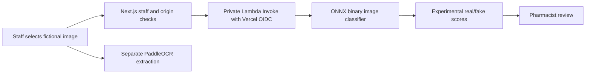

# Prescription real/fake research classifier

## Current state

The app has a separate, staff-protected classification panel and `/api/prescriptions/classify` route. The model service contains a ResNet18 training/export pipeline and an ONNX Runtime Lambda handler. **No verified real/fake dataset or trained authenticity model is included, and no AWS resources have been provisioned.** The existing Ontario demo tests OCR only. The classifier remains unconfigured until an evaluated model is connected.

This is a binary image-classification research extension. It cannot establish that a prescriber authorized a document, identify every forgery, or authorize dispensing. A visually identical unauthorized copy may be indistinguishable from an authorized prescription. Model scores are uncalibrated model outputs, not probabilities of authenticity. The website remains a fictional-data demonstration.

## Data and evaluation

Follow [the model service guide](../services/prescription-classifier/README.md) to prepare the manifest, validate splits, train, and export. Labels must have independent provenance. Keep related originals, altered copies, repeated scans, renders, and augmentations in one group/split; separate templates and acquisition sources where possible. De-identification must be consistent across both labels so it does not reveal the answer.

The pipeline preserves the full page using a shared resize/pad transform; a 224-pixel baseline may still lose fine alteration evidence. Evaluate that limitation before choosing a larger or patch-based model. Report the confusion matrix, fake recall, fake examples predicted real, and real examples predicted fake on an untouched test set. Do not publish software-smoke accuracy as prescription-authenticity performance. Synthetic geometric fixtures only test training/export mechanics and cannot be served as a model.

## Architecture



The browser sends the image only when **Classify selected image** is clicked. Next.js limits the raw upload to 4 MiB and invokes Lambda synchronously with a base64 image. The handler checks decoded size, format, pixel bounds, and model metadata. Results contain only the version, label, scores, timing, and review requirement. Uploads and predictions are not written to the database, dashboard, browser storage, or application logs. AWS/platform operational logs have their own retention settings. Existing OCR behavior is independent of the classifier.

The AWS templates use a private ECR repository and Lambda container with no Function URL or API Gateway. The Lambda execution role can write only its own logs; it has no data-store permissions. Vercel receives short-lived credentials through a role that can invoke only this function. The trust policy is restricted to the exact team, project, and production environment. Preview deployments are deliberately excluded.

## Local service and website

Build/run the Lambda emulator as described in the service guide, bound to `127.0.0.1:8003`. An absent or smoke-test model returns 503 with no prediction.

In a separate PowerShell terminal, from the project root:

```powershell
$env:PRESCRIPTION_CLASSIFIER_LOCAL_URL = 'http://127.0.0.1:8003/2015-03-31/functions/function/invocations'
npm.cmd run dev:prescriptions
```

Open `http://localhost:3001/prescriptions`. The isolated launcher clears hosted classifier settings for its child process and reads only the explicitly supplied local URL; it preserves `.env.local`. A configured endpoint is not a claim that a trained model is ready. The UI displays a private error and keeps the image if inference fails. Select a different image to clear the previous prediction. Without a local URL, the panel says **Model not connected**.

## AWS deployment preparation

Deployment requires a verified dataset, an evaluated model artifact, AWS CLI access to the intended account, and an agreed budget. These steps create chargeable resources; do not run them merely to display an unavailable model.

Use the official [AWS CLI installation](https://docs.aws.amazon.com/cli/latest/userguide/getting-started-install.html) and [console-based `aws login`](https://docs.aws.amazon.com/cli/latest/userguide/cli-configure-sign-in.html). Keep credentials out of chat, source, and `.env.local`. Use a named profile and check `aws sts get-caller-identity --profile pharmacy-capstone` before any deployment. A console account ID is not a CLI credential.

1. Review `infra/aws/classifier-registry.json` and `classifier-stack.json`. Confirm the deployment region, monthly budget, Vercel team slug, project name, and whether the team already has an AWS OIDC provider. The console screenshot showed `us-east-1`; select the intended region explicitly.
2. Confirm the model's held-out evaluation and runtime readiness using the service guide. Do not deploy a pipeline smoke-test artifact.
3. Create the private registry in the chosen region:

   ```powershell
   aws cloudformation deploy --profile pharmacy-capstone --region us-east-1 --stack-name pharmacy-classifier-registry --template-file infra/aws/classifier-registry.json
   aws cloudformation describe-stacks --profile pharmacy-capstone --region us-east-1 --stack-name pharmacy-classifier-registry --query 'Stacks[0].Outputs'
   ```

4. Build a single-architecture Linux image with the evaluated artifacts, authenticate Docker using `aws ecr get-login-password` piped into `docker login --password-stdin`, tag a new immutable version, and push to the returned repository URI. Never echo the ECR password. Use `aws ecr describe-images` to obtain the pushed digest; the function template requires `repository@sha256:digest`, not a mutable tag. The registry explicitly permits image retrieval by the named Lambda function in the same account/region. If changing `FunctionName`, pass the same value to both templates. The deployment identity still needs the required ECR repository, image-push, and CloudFormation/IAM provisioning permissions.
5. Inspect existing IAM OIDC providers before deployment. Set `ExistingOidcProviderArn` if the team's provider already exists. Its issuer must be `https://oidc.vercel.com/<team-slug>` and audience `https://vercel.com/<team-slug>`. Confirm Vercel uses **team issuer** mode; do not silently change or recreate an existing provider.
6. Deploy the inference template with the image digest and exact team slug:

   ```powershell
   aws cloudformation deploy --profile pharmacy-capstone --region us-east-1 --stack-name pharmacy-classifier --template-file infra/aws/classifier-stack.json --capabilities CAPABILITY_IAM --parameter-overrides ImageUri=YOUR_ECR_URI_AT_SHA256_DIGEST VercelTeamSlug=YOUR_EXACT_TEAM_SLUG VercelProjectName=pharmacy-assistant-capstone
   ```

   Include `ExistingOidcProviderArn=...` when reusing a provider. The stack defaults to 1,024 MB, a 30-second timeout, two reserved concurrent executions, and seven-day log retention. If a new account's Lambda concurrency quota cannot support the reservation, request the quota adjustment or review a suitable limit; do not remove the limit without considering cost. The private registry is retained on stack deletion so model versions are not silently erased.
7. Read the stack outputs and set these **server-only Vercel Production** variables, preserving all existing settings:

   ```text
   PRESCRIPTION_CLASSIFIER_AWS_REGION=<AwsRegion>
   PRESCRIPTION_CLASSIFIER_FUNCTION_NAME=<FunctionName>
   PRESCRIPTION_CLASSIFIER_AWS_ROLE_ARN=<VercelRoleArn>
   ```

   Do not set `PRESCRIPTION_CLASSIFIER_LOCAL_URL` in Vercel. No permanent AWS access key is required. Redeploy the website after changing environment settings.
8. Invoke the model with a permitted evaluation fixture directly, then through the signed-in website. Check the same model version/scores, failure behavior, and a new image replacing the old result. Confirm successful OCR still works separately. Cloud deployment is not verified by a local build or a console screenshot.

## Cost and rollback

The templates use on-demand Lambda without provisioned concurrency or a permanently running training server. Training is local. ECR image storage, Lambda requests/compute, logs, and any transfer remain billable. At the published US East x86 rates, **1,000 invocations at 1 GiB for 5 seconds each** would be about **US$0.084 in Lambda compute/requests**, before free-tier credits, storage, logs, transfers, or taxes. This is an illustrative calculation, not measured model latency or a monthly cap. ECR private storage is listed at US$0.10 per GB-month. Confirm current regional prices and measured cold/warm latency before approving a budget. [Lambda pricing](https://aws.amazon.com/lambda/pricing/), [ECR pricing](https://aws.amazon.com/ecr/pricing/).

Set an AWS Budget alert appropriate to the agreed amount. Alerts and concurrency limits are **not hard spending caps**. To stop new app requests, remove the classifier connection variables and redeploy Vercel; OCR remains available independently. Retain evaluated version digests for explicit rollback. Review and remove unused cloud resources separately when finished.

## Implementation checks (2026-10-31)

- `npm test`: 148 JavaScript tests passed, including 15 classifier parser/API/provider tests with mocked AWS calls.
- `npm run lint` and `npm run build`: passed. ESLint now excludes Python virtual environments so it does not lint third-party PyTorch JavaScript.
- Current `cfn-lint` 1.59.0: both AWS templates passed with no findings. Static validation does not verify account access, image deployment, OIDC settings, quotas, or spending.
- Browser check: Ontario OCR fixture still returned 12/12 fields, 30 lines, in 13.8 seconds while the classifier correctly showed **Model not connected** with no score.
- The classifier service README records its Python, training/export parity, and real Lambda-emulator checks. None of those tests establishes prescription-authenticity accuracy.
- npm installation reported existing Better Auth peer conflicts and dependency security advisories. A scoped Zod override fixes the affected transitive version used by the new OIDC provider. The final audit still reports 26 advisories (6 low, 16 moderate, 3 high, 1 critical), including the existing Better Auth dependency. This task does not upgrade the authentication stack or certify its security.

## References

- [PyTorch transfer learning](https://docs.pytorch.org/tutorials/beginner/transfer_learning_tutorial.html)
- [ResNet18](https://docs.pytorch.org/vision/stable/models/generated/torchvision.models.resnet18.html)
- [Lambda container requirements](https://docs.aws.amazon.com/lambda/latest/dg/images-create.html)
- [Lambda quotas](https://docs.aws.amazon.com/lambda/latest/dg/gettingstarted-limits.html)
- [Vercel to AWS OIDC](https://vercel.com/docs/oidc/aws)
