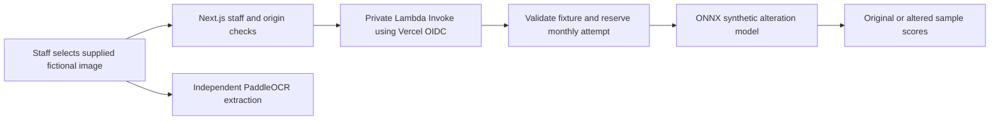

# Synthetic prescription alteration demo

## Current scope and status

The `/prescriptions` page has a **Synthetic alteration demo** alongside the independent PaddleOCR workflow. It classifies supplied fictional images as **Original sample** or **Altered sample**. Local training, 151 JavaScript tests, 86 Python tests, Docker runtime inference, the complete browser flow, final lint/build, and updated stack lint have passed. AWS sign-in and deployment are still pending; no AWS resources have been created for this update.

This model does not assess prescription authenticity. Both classes are visibly fictional, unsigned educational documents. A result describes a synthetic visual class; it does not establish prescriber authorization, clinical appropriateness, or permission to dispense. Model scores are not probabilities of authenticity.

The older `real`/`fake` research pipeline remains available for future work with independently verified data. No verified authenticity dataset or trained authenticity model is included. Synthetic classes must never be renamed to imply that such validation has occurred.

## Why synthetic samples

The public-data review did not confirm an independently verified, appropriately licensed prescription-image dataset with genuine/forged labels suitable for this task. This is a search result, not a claim that no such dataset exists.

| Source checked | What it provides | Limitation for this project |
| --- | --- | --- |
| [Mendeley bilingual prescription dataset](https://data.mendeley.com/datasets/tg2hm7n2bs/1) | 600 redacted handwritten prescriptions from Bangladesh, with Bangla/English transcription annotations and a CC BY 4.0 licence. | OCR labels do not establish authenticity or forgery labels. |
| [Official DocTamper repository](https://github.com/qcf-568/DocTamper) | A general document-text tampering benchmark. | Access requires the documented institutional application and noncommercial conditions; it is not a prescription-authenticity dataset. |
| [Soleymani et al., prescription fraud research](https://pmc.ncbi.nlm.nih.gov/articles/PMC6279664/) | Unsupervised analysis of structured prescription/insurance records. | The paper reports unavailable fraudulent/legitimate labels; it does not supply image-classification ground truth. |

None of these datasets was downloaded or used for training. The project instead generates paired fictional originals and visible alterations, including strikeouts, pasted blocks, overprinting, and duplicated fields. Both classes have identical demo-watermark regions. Related originals and alterations stay together, and template layouts are separated between training, validation, and test splits. The public sample pair is selected before training or inference; its selection and hashes are recorded in [the sample manifest](../public/demo/classifier/manifest.json).

Synthetic held-out metrics describe this generator and its visible edits only. They are not real-world forgery detection results. Follow [the model service guide](../services/prescription-classifier/README.md) for generation, training, ONNX export, artifact checks, and evaluation details. The old geometric software-smoke artifact remains unsuitable for serving.

## Measured synthetic model

The v2 model `resnet18-caf5359a14d1` was trained for five epochs, with epoch 5 selected. Its generated dataset contains 384 images: 192 training, 96 validation, and 96 held-out test images. The exported model's held-out confusion matrix is shown with actual classes in rows and predicted classes in columns:

| Actual class | Predicted original | Predicted altered |
| --- | ---: | ---: |
| Original sample | 47 | 1 |
| Altered sample | 17 | 31 |

Accuracy and balanced accuracy were **81.25%** on these 96 synthetic test images. Alteration recall was **64.58%**: the model missed **17 of 48 altered samples** and incorrectly flagged **1 of 48 originals**. These errors limit even the narrow synthetic task. The results do not measure prescription authenticity, unseen real-world edits, or clinical performance. The public sample pair was fixed before inference; it was not chosen to improve the displayed predictions.

## Try the page locally

1. Build and start the synthetic-mode Lambda emulator using the model service guide. Bind it to `127.0.0.1:8003`. Local emulation uses `CLASSIFIER_LOCAL_EMULATOR=1` and the synthetic deployment mode; it does not create a DynamoDB table or call AWS.
2. From the project root, start Next.js in a separate PowerShell terminal:

   ```powershell
   $env:PRESCRIPTION_CLASSIFIER_LOCAL_URL = 'http://127.0.0.1:8003/2015-03-31/functions/function/invocations'
   npm.cmd run dev:prescriptions
   ```

3. Open `http://localhost:3001/prescriptions`. Choose **Load original demo** or **Load altered demo**, acknowledge fictional data, and choose **Classify demo sample**.
4. Compare the result and both model scores with the selected image. Changing the image clears the previous prediction and consent.

The synthetic runtime permits only the supplied images whose SHA-256 hashes are recorded in the model artifact. Other uploads return 422 with a prompt to use the demo loaders. The separate **Load Ontario demo** button is for **Extract with PaddleOCR**; that OCR fixture is not a classifier sample. OCR does not need to be configured to run the classifier.

The isolated Next.js launcher sets `PRESCRIPTION_CLASSIFIER_MODE=synthetic_demo`, clears hosted classifier/database/Auth settings in its child process, and preserves `.env.local`. Without a local classifier URL, the panel shows **Model not connected** and no prediction. A configured endpoint alone does not establish model readiness.

## Request contract and privacy



`GET /api/prescriptions/classify` reports `{configured, mode}`. `mode` defaults to `synthetic_demo`; an explicit `PRESCRIPTION_CLASSIFIER_MODE=research` supports a separate compatible research artifact. The adapter rejects responses from a different mode. Legacy availability responses without a mode are parsed as research mode for compatibility.

`POST` requires staff access, same-origin validation, fictional-data acknowledgement, and raw PNG/JPEG bytes capped at 4 MiB. Next.js invokes Lambda synchronously with a schema-1 base64 request envelope. A successful synthetic response body has this contract:

```typescript
type SyntheticResult = {
  schemaVersion: 2,
  mode: "synthetic_demo",
  modelVersion: string,
  predictedLabel: "original_demo" | "altered_demo",
  scores: { original_demo: number, altered_demo: number },
  validationStatus: "synthetic_demo_only",
  authenticityAssessed: false,
  reviewRequired: true,
  durationMs: number
};
```

Both scores must be finite, within 0–1, and sum to one within the parser tolerance. Exact ties resolve to `altered_demo`. The parser projects only the public fields and discards extras. Schema-1 `real`/`fake` results retain their separate `research_only` status; they are not accepted in synthetic mode.

The image is sent only when its action button is clicked. Uploads and classification details are processed in memory and are not saved to the pharmacy database, dashboard, browser storage, or application logs. The DynamoDB guard stores only a per-function/month counter and expiration time. Platform operational logs have separate retention settings. The browser retains a selected image after recoverable errors; image changes and page exit clear predictions.

## Under-US$5 monthly target

The agreed target is **under US$5/month for this small AWS classifier demo**. Training stays local. The stack uses on-demand Lambda, private ECR, a small on-demand DynamoDB counter, and seven-day logs. It does not create a GPU server, API Gateway, or provisioned concurrency.

The hosted guard admits at most **500 inference attempts per function per UTC calendar month**. It reserves an attempt with an atomic conditional DynamoDB update before loading/running the model. Failed or timed-out attempts are not refunded. Exhaustion returns 429; the next UTC month uses a new counter. Missing or unavailable guard configuration returns 503 without inference. Counter records have TTL cleanup after their retention period.

At the published US East x86 rate, 500 calls at **1 GiB for 30 seconds each** give this planning estimate, before free-tier credits:

```text
500 × 1 GiB × 30 seconds × US$0.0000166667 per GB-second ≈ US$0.25 compute
500 × US$0.20 per million requests                     ≈ US$0.0001 requests
```

The template sets 1,024 MB memory and a 30-second timeout. The calculation covers that assumed work for admitted calls; it is **not an account-wide hard billing cap**. Initialization, rejected requests, retries from callers, logs, DynamoDB usage, data transfer, taxes, and retained images can add charges. [AWS Lambda pricing](https://aws.amazon.com/lambda/pricing/).

Private ECR storage is listed at US$0.10 per GB-month: 1 GB of retained billed storage would add about US$0.10/month, while additional versions accumulate storage. DynamoDB charges depend on its requests and storage. Keep only reviewed versions needed for rollback and inspect the actual bill. [ECR pricing](https://aws.amazon.com/ecr/pricing/), [DynamoDB pricing](https://aws.amazon.com/dynamodb/pricing/).

Existing AWS services and the app's Vercel, Neon, Jev, or separately hosted OCR costs are outside this classifier estimate. Configure budget notifications around the US$5 target; alerts and reserved concurrency are not spending caps. Actual AWS billing remains unverified until the authorized deployment is measured.

## AWS deployment preparation

AWS CLI 2.39.3 is installed for the current user. The first sign-in attempt expired; a second attempt is awaiting completion. Account authentication, account review, and deployment remain pending. No AWS resources have been created for this update. The steps below describe the intended deployment; they are not a record of completed actions. Use a named AWS CLI profile and confirm the target account and region before provisioning. See [AWS CLI installation](https://docs.aws.amazon.com/cli/latest/userguide/getting-started-install.html) and [console-based AWS CLI sign-in](https://docs.aws.amazon.com/cli/latest/userguide/cli-configure-sign-in.html).

1. Review the synthetic artifact and its held-out metrics using the service guide. Package a synthetic-mode artifact with the public sample allowlist; do not package the geometric smoke artifact or relabel a synthetic model as an authenticity model.
2. Review `infra/aws/classifier-registry.json` and `classifier-stack.json`, the US$5 target, intended AWS account/region, and exact Vercel team/project. Inspect existing IAM OIDC providers. Reuse a matching team provider with `ExistingOidcProviderArn`; it must have issuer `https://oidc.vercel.com/<team-slug>` and audience `https://vercel.com/<team-slug>`. Vercel must use team-issuer mode.
3. Create the private registry in the chosen region:

   ```powershell
   aws sts get-caller-identity --profile pharmacy-capstone
   aws cloudformation deploy --profile pharmacy-capstone --region us-east-1 --stack-name pharmacy-classifier-registry --template-file infra/aws/classifier-registry.json
   aws cloudformation describe-stacks --profile pharmacy-capstone --region us-east-1 --stack-name pharmacy-classifier-registry --query 'Stacks[0].Outputs'
   ```

4. Build the single-architecture Linux/amd64 synthetic image using the service guide. Authenticate Docker using `aws ecr get-login-password` piped into `docker login --password-stdin`, then push a new immutable image version. Obtain its digest with `aws ecr describe-images`; deployment requires `repository@sha256:digest`. The repository permits retrieval by the named Lambda function in the same account/region. If changing `FunctionName`, pass the same name to both templates. The deployment identity needs the relevant ECR, CloudFormation, IAM, Lambda, Logs, and DynamoDB provisioning permissions.
5. Deploy the function, usage table, and scoped roles:

   ```powershell
   aws cloudformation deploy --profile pharmacy-capstone --region us-east-1 --stack-name pharmacy-classifier --template-file infra/aws/classifier-stack.json --capabilities CAPABILITY_IAM --parameter-overrides ImageUri=YOUR_ECR_URI_AT_SHA256_DIGEST VercelTeamSlug=YOUR_EXACT_TEAM_SLUG VercelProjectName=pharmacy-assistant-capstone
   ```

   Add `ExistingOidcProviderArn=...` when reusing a provider. The stack has no Function URL or API Gateway. It sets two reserved concurrent executions, 512 MB temporary storage, and these Lambda environment variables:

   ```text
   CLASSIFIER_DEPLOYMENT_MODE=synthetic_demo
   CLASSIFIER_USAGE_TABLE=<stack-created table>
   CLASSIFIER_MONTHLY_MAX_CALLS=500
   ```

   The Lambda role can write its own logs and update only its usage table. The Vercel role can invoke only the classifier, with exact team/project/production OIDC claims. It cannot access the counter table. Existing provider reuse preserves that provider's configuration. Check the account's available concurrency quota before deployment.
6. Read the stack outputs and add these **server-only Vercel Production** variables, preserving all existing settings:

   ```text
   PRESCRIPTION_CLASSIFIER_AWS_REGION=<AwsRegion>
   PRESCRIPTION_CLASSIFIER_FUNCTION_NAME=<FunctionName>
   PRESCRIPTION_CLASSIFIER_AWS_ROLE_ARN=<VercelRoleArn>
   PRESCRIPTION_CLASSIFIER_MODE=synthetic_demo
   ```

   Do not set the local emulator URL on Vercel or add permanent AWS keys. Redeploy the website after updating its environment.
7. Test the two supplied samples directly and through the signed-in page. Confirm matching model versions/scores, 422 rejection of an unrelated fictional image, the quota failure path, image-change clearing, and independent OCR operation. Use a local isolated guard test for limit exhaustion rather than consuming the hosted monthly allowance just to test it.

To stop inference, set the classifier's reserved concurrency to zero; disconnect its Vercel variables and redeploy to stop new website requests. Storage may continue to cost money. The registry is retained on stack deletion, so review and remove unneeded resources explicitly rather than assuming deletion removes every charge. Rollback uses a reviewed prior image digest and preserves the usage counter.

## Validation status for the synthetic update

The entries below distinguish completed checks from work still awaiting final evidence. Earlier research-scaffold checks do not establish the new synthetic behavior.

| Check | Status / evidence |
| --- | --- |
| Synthetic generation, training, export, and held-out metrics | **PASSED locally.** v2 model `resnet18-caf5359a14d1`; 384 images split 192/96/96; five epochs, best epoch 5. Held-out matrix `[[47,1],[17,31]]`, 81.25% accuracy/balanced accuracy, 17/48 alterations missed. Synthetic evaluation only. |
| Python synthetic-runtime and monthly-guard tests | **PASSED.** 86 Python tests, including 42 focused cost-guard tests. |
| Real Docker Lambda emulator: supplied pair and wrong-image rejection | **PASSED.** Original sample → `original_demo` with score 0.5481; altered sample → `altered_demo` with score 0.5665. An unrelated image returned 422. Observed calls were 245 ms and 82 ms; container memory was 223.2 MiB. These are local measurements, not AWS billing measurements. |
| JavaScript tests, lint, production build | **PASSED.** `npm test` reported 151 tests, including 18 classifier tests. Final `npm.cmd run lint` and `npm.cmd run build` both exited 0 after the duration-display adjustment. |
| Updated CloudFormation stack including the quota table | **PASSED.** The updated `classifier-stack.json` passed `cfn-lint`; this is static validation, not AWS provisioning. |
| Browser flow: both supplied samples and result replacement | **PASSED locally through Next.js.** Both samples returned predictions end to end. Changing the image cleared the old prediction and reset fictional-data consent. |
| Final browser checks: rejected image and independent OCR | **PASSED.** Classifying the Ontario OCR fixture showed the supplied-samples-only message and no stale prediction. Independent PaddleOCR extracted 12/12 fields with zero missing fields in 16.9 seconds. |
| AWS account authentication, deployment, production OIDC, quota, and measured cost | **PENDING.** AWS CLI 2.39.3 installed; the first sign-in expired and the second is awaiting completion. No AWS resources created. |

## References

- [Model service and reproducible commands](../services/prescription-classifier/README.md)
- [ResNet18 architecture](https://docs.pytorch.org/vision/stable/models/generated/torchvision.models.resnet18.html)
- [AWS Lambda container requirements](https://docs.aws.amazon.com/lambda/latest/dg/images-create.html)
- [AWS Lambda quotas](https://docs.aws.amazon.com/lambda/latest/dg/gettingstarted-limits.html)
- [Vercel to AWS OIDC](https://vercel.com/docs/oidc/aws)
